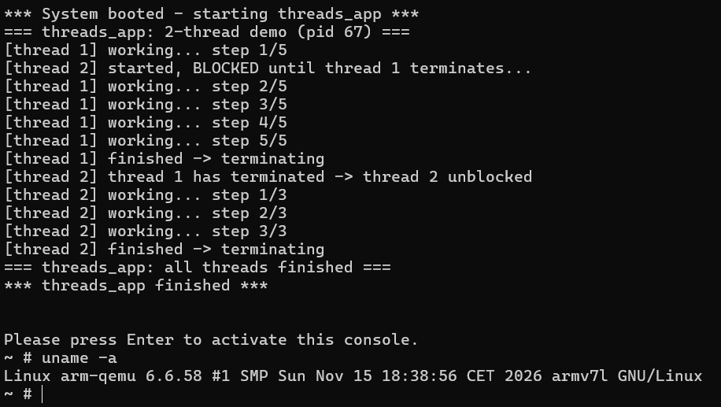

# Embedded Linux from scratch on ARM (QEMU + WSL2)

Build a **minimal embedded Linux system for a 32-bit ARM board**, by hand, on an ordinary x86 PC, and boot it
in QEMU. No Buildroot, no Yocto: every piece (toolchain, C library, BusyBox, root filesystem, init scripts,
kernel) is put together manually, so you see exactly what each one does. Written for beginners: every term is
explained, and every step ends with what goes wrong if you skip or misconfigure something.



## What you build

```
 HOST  (your x86_64 PC, Ubuntu in WSL2)                                    TARGET  (ARM board emulated by QEMU)

 threads_app.c  ──┐
 BusyBox source ──┤  cross-compile             mke2fs
 glibc for ARM  ──┼─────────────────► rootfs/ ────────► arm.img ─────────► SD card, mounted as  /
 inittab, rcS   ──┘   + copy

 Linux source   ──────── cross-compile ──────────────► zImage + dtb ─────► kernel + board description
```

- **`threads_app`**: a C program with **two POSIX threads** running two different functions. Thread 2 stays
  **blocked until thread 1 terminates** (`pthread_join`). It **starts automatically** at boot.
- **`arm.img`**: a 64 MB ext2 image holding the root filesystem: `/bin /sbin /usr /lib /etc /dev /proc /sys /tmp /root`.
- **`zImage` + `vexpress-v2p-ca9.dtb`**: a Linux 6.6 LTS kernel and the device tree of the board.

## How it boots

```
qemu-system-arm  (emulated vexpress-a9 board, Cortex-A9 CPU)
   │ loads zImage + dtb, attaches arm.img as an SD card
   ▼
Linux kernel
   │ mounts /dev/mmcblk0 (= arm.img) as "/"
   ▼
/sbin/init  (BusyBox, PID 1) ── reads /etc/inittab
   ├─► ::sysinit  → /etc/init.d/rcS
   │                ├─ mounts /proc /sys /tmp (/dev)
   │                └─ runs /usr/bin/threads_app      ← starts automatically
   └─► ::askfirst → /bin/sh on the serial console
```

## What you learn

| Topic | Where |
|---|---|
| Cross-compilation: toolchain, target triplet, sysroot, ABI (armel) | Steps 1–2 |
| ELF executables, dynamic linking, the dynamic loader `ld-linux.so.3` | Steps 2, 4 |
| POSIX threads and synchronization with `pthread_join` | Step 2 |
| BusyBox (one binary, hundreds of commands) and the root filesystem layout | Steps 3–4 |
| Boot sequence: init (PID 1), `inittab`, `rcS`, device nodes, devtmpfs | Step 4 |
| Building an ext2 filesystem image without mounting it | Step 5 |
| Configuring and building the Linux kernel, device trees | Step 6 |
| Board emulation, serial console, reading a boot log to debug | Step 7 |

## Start here

1. **[00 — Concepts & glossary](00-concepts-glossary.md)**: the big picture in diagrams, then every term explained
2. **[01 — Roadmap](01-roadmap.md)**: requirements, the 7 steps, and the design choices
3. The steps:
   1. [Set up WSL2 Ubuntu + tools](steps/step-1-setup-wsl.md)
   2. [Write & cross-compile the two-thread app](steps/step-2-application.md)
   3. [Build BusyBox](steps/step-3-busybox.md)
   4. [Assemble the root filesystem](steps/step-4-rootfs.md)
   5. [Create `arm.img`](steps/step-5-image.md)
   6. [Build the Linux kernel](steps/step-6-kernel.md)
   7. [Boot in QEMU (and debug the boot)](steps/step-7-boot-qemu.md)

**Time:** about 1–1.5 h, mostly waiting for builds. **Needs:** Windows 10/11 with WSL2 (or any Linux), 8 GB RAM, ~10 GB disk.

## Tools used

Ubuntu 24.04 · `gcc-arm-linux-gnueabi` (GCC 13, glibc 2.39) · BusyBox 1.36.1 · Linux 6.6 LTS · QEMU (`qemu-system-arm`, board `vexpress-a9`)

## Repository layout

```
arm-linux-from-scratch/
├── README.md                ← overview (this page)
├── 00-concepts-glossary.md  ← the big picture + every term explained
├── 01-roadmap.md            ← requirements, plan, design choices
├── steps/                   ← one guide per step (1 to 7)
├── files/                   ← sources, copied into the build folder in Step 1
│   ├── threads_app.c        ← the two-thread application
│   ├── inittab              ← BusyBox init configuration
│   ├── rcS                  ← boot script: mounts, hostname, autostart
│   └── env.sh               ← build environment variables
└── docs/screenshot.png      ← the system running in QEMU
```

## License

[MIT](LICENSE)
